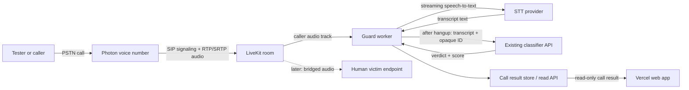

# Voice Scam Guard — Master Plan

- **Status:** Proposed feature; master plan ready for review
- **Project phase:** Later / stretch; separate from the iMessage MVP
- **Branch:** `feat/voice-scam-detection`
- **Last updated:** 2026-11-08

## Goal

Route calls to a Photon voice number through a voice application that can transcribe the caller, send transcript text to T-Gate's classifier, and show a potential-scam warning in the Vercel web app. The intended progression is to classify after a test caller hangs up, then move classification and warnings into the active call. A later two-party stage connects the caller to a human victim while the guard listens to the caller's audio.

This is a plan, not a change to the current iMessage MVP. The detailed task tracker is [`docs/features/voice-scam-guard.md`](../docs/features/voice-scam-guard.md).

## Interview decisions

- The Photon number is intended to be the victim's call entry point.
- The repository's Photon project is confirmed as Photon 2.0/Beta by the current gateway setup; whether the voice number is on that project and is eligible for Voice still needs verification.
- The first proof is a human tester calling that Photon number. The app captures only the caller's speech; it classifies after hangup.
- The main follow-up is a warning while the call is still active.
- Retain the transcript and verdict for the prototype. Do not retain raw call audio.
- The production call should let the caller and victim talk while the guard listens to the caller's audio. The exact victim endpoint (phone bridge or browser) is still open.
- Warnings appear in the Vercel web app. Automatic call blocking, hangup, or spoken intervention is not in the requested first two stages.

## Feasibility answer

**Yes, the call can be observed if it is routed through Photon into a SIP media application. A normal Photon message webhook cannot record or deliver the live call audio.**

Photon documents voice as a SIP path. Its Stable Spectrum voice guide says calls go from a Photon line to a SIP application and explicitly says not to expect calls in `app.messages` or `app.webhook()`; voice webhooks are listed as coming soon. The Photon 2.0/Beta LiveKit cookbook instead documents this inbound path:

```text
caller → Photon number → Voice profile → SIP → LiveKit room
```

In that room, a LiveKit app or agent can subscribe to the caller's audio track and run speech-to-text. It can send transcript text and an opaque call or segment ID to the existing classifier. A result service can persist the transcript and verdict and expose them for the Vercel page to render.

This routing condition matters: if a caller dials a separate victim number directly and the call never passes through Photon or another media bridge, the Photon webhook will not see it. To protect a person, the voice application must keep the caller connected to a victim endpoint, such as a second phone reached over SIP or a browser participant in the LiveKit room.

The repository's current iMessage line is a shared-pool line. Photon 2.0's LiveKit voice guide says shared iMessage assignments do not support Voice; it lists eligible SMS, WhatsApp, or dedicated iMessage lines. The team has said it set up a voice number, but its exact Photon version, line type, and Voice-profile status still need verification. Do not route calls to the shared iMessage line on the assumption that it is voice-capable.

### Product-version distinction

| Photon path | What the official docs say | Planning implication |
|---|---|---|
| Stable Spectrum | Inbound calls route to a SIP app; call webhooks and SDK call control are still marked coming soon. The current voice guide says RTP audio on its SIP side is not encrypted. | Do not build a voice monitor around the existing message webhook. Confirm current security and product limitations before selecting this path. |
| Photon 2.0 / Beta | Voice profiles route calls over SIP; the published LiveKit guide connects an inbound Photon call to a LiveKit room and supports encrypted media when both sides configure SRTP. Shared iMessage assignments are not eligible for Voice. | **Recommended starting point**, as an inference from the repository's current Photon 2.0/Beta webhook path and the published LiveKit cookbook. Verify the actual number and account configuration first. |

## Proposed call and data flow



The guard worker, not the Vercel page, receives media and calls the classifier. The classifier receives text only. The web app renders the backend result and does not decide whether a call is a scam.

## Staged implementation

### Stage 0: confirm the voice route

1. Identify whether the voice number is Photon 2.0/Beta or Stable Spectrum, and confirm the number is voice-capable.
2. Confirm a Photon Voice profile, its inbound SIP destination, and whether the call can be routed to a LiveKit room. Keep the shared iMessage line out of this test unless Photon confirms it is eligible.
3. Check LiveKit, speech-to-text, and call usage costs before provisioning paid resources. Keep credentials in local or hosted secret storage, never in the repository.
4. Place a consented test call and verify the SIP application sees the caller and receives usable audio.

**Done when:** the test call reaches the chosen media application and the account/line requirements and costs are documented.

### Stage 1: caller-only capture and after-call result

1. Receive the test caller as a SIP participant in LiveKit.
2. Stream the caller's audio to speech-to-text during the call and buffer transcript text for that call. Do not save raw audio. When the call ends, finalize the transcript and send it to `POST /classify` with an opaque call or segment ID.
3. Store the transcript and final verdict for the demo. Define a transcript retention period before real user calls; this remains TBD.
4. Add a versioned call-result contract and read-only API for the Vercel app. Show transcript, potential-scam/legitimate result, score, and model. Keep credentials and classifier calls server-side.
5. Test with short, consented scam-style and legitimate scripts. This stage proves call audio → transcript → classifier → web result; it does not yet prove a two-person protected call.

**Done when:** a tester can call the Photon number, speak, hang up, and see a transcript and classifier result in the web app, with no persisted audio.

### Stage 2: connect a human victim

1. Add the victim as a second call leg: either an outbound SIP/PSTN bridge to a handset or a browser participant in the LiveKit room. Choose the endpoint before implementation.
2. Keep scoring after hangup for this stage. Verify that the guard subscribes to the caller's participant track so the victim's own speech is not scored as scammer dialogue.
3. Confirm two-way audio, call setup and hangup behavior, and failure handling. Calls should continue if speech recognition or classification is unavailable; mark the result unverified.

**Done when:** the caller and human victim can hold a normal conversation through the routed call, and the after-call transcript contains only caller speech.

### Stage 3: live classification and warning

1. Move scoring from call-end to active-call processing. Prefer finalized utterances or stable transcript segments over raw unstable partial text.
2. Define transcript windowing, aggregation, score thresholds, warning delay, and duplicate-warning suppression. The classifier was built for text messages, so do not treat its first score on a call transcript as validated call-level accuracy.
3. Publish live call status and warning updates to the Vercel app through a read-only, versioned interface. The current page polls `GET /api/messages`; it has no live call event contract. Choose an appropriate transport during implementation, such as LiveKit data messages or a separately hosted event endpoint.
4. Show warnings as **potential scam**, with enough score/context to avoid presenting a model output as certainty. Keep the call connected; call control is not part of this stage.
5. Measure transcript delay, classification delay, false warnings, and missed scripted scam cues before choosing thresholds.

**Done when:** the Vercel app shows a warning during a bridged caller–victim test call, with measured latency and documented false-warning behavior.

## Classifier and transcript constraints

- The current service accepts `POST /classify` with `{ messageId, text }`; it does not accept audio. Its output is `{ label, score, category, model, highlights }`.
- The current training data and evaluation are SMS/text-message oriented. Voice transcripts have pauses, repetition, ASR errors, turn context, and longer length. Stage 1 is a plumbing experiment, not evidence that the current model is suitable for real calls.
- The current MiniLM inference code accepts up to 50,000 characters but notes that MiniLM truncates to 256 tokens. Long calls therefore need caller-only transcript windows and a call-level aggregation rule, or a separately evaluated model. Do not silently assume one full-call request covers every utterance.
- Create a small held-out set of consented or synthetic call transcripts, including legitimate calls and scam scripts, before selecting a live threshold. The dataset source, labels, evaluation metrics, and whether to retrain are TBD.
- If the classifier or STT service is unavailable, the call must not be terminated by the guard. Show an unavailable/unverified state; do not label it legitimate.

## Privacy and operation

- Raw audio is not retained for the requested prototype. It is streamed only as needed for STT and is not sent to the classifier.
- The prototype retains transcripts and verdicts. Retention duration, access control, and whether transcripts appear in the UI beyond the demo session are TBD.
- Use consented test calls. Before real-user or public calls, resolve caller disclosure and applicable consent/privacy requirements for the operating jurisdictions.
- Do not place phone numbers, Photon IDs, SIP credentials, or raw handles in the classifier request or public event contract. Use an opaque call ID.
- Keep model scoring and call routing server-side. The Vercel UI is a read-only display of call status and verdict.
- Confirm transport encryption for both SIP signaling and audio media. Photon Stable's published Spectrum voice path currently documents unencrypted RTP; the Photon 2.0 LiveKit cookbook documents configuring TLS/SRTP on both sides.

## Open questions

- Does the configured voice number belong to the team's Photon 2.0/Beta project, and what exact line type/Voice profile does it use?
- What speech-to-text provider/model and host should be used? What latency, accuracy, language, and cost targets apply?
- Should the final victim endpoint be a real handset via an outbound SIP leg or a browser participant?
- How long should transcripts remain stored, and who can view them?
- What transcript chunking and call-level aggregation should map multiple utterances to one warning?
- What call-like dataset and test criteria will validate scam/legitimate detection?
- What live warning transport and UI placement should be used?
- What are acceptable warning latency, score threshold, and false-positive rate?
- What caller disclosure and consent process is needed before calls beyond consented tests?
- What should the UI show when STT or classification is unavailable?

## Sources

- [Photon Stable Spectrum voice](https://photon.codes/docs/spectrum-ts/providers/voice) — SIP call routing, current support matrix, webhook status, and RTP encryption note.
- [Photon Stable inbound calls](https://photon.codes/docs/spectrum-ts/providers/voice/inbound-calls) — inbound SIP route requirements and test call steps.
- [Photon 2.0/Beta LiveKit SIP cookbook](https://photon.codes/docs/beta/cookbooks/voice/livekit) — Photon Voice profiles, LiveKit inbound trunks, call direction, eligible line types, and TLS/SRTP setup.
- [Photon 2.0/Beta voice quickstart](https://photon.codes/docs/beta/get-started/voice) — confirms phone audio is routed over SIP and not through the messaging HTTP endpoint.
- [LiveKit media overview](https://docs.livekit.io/transport/media/) and [LiveKit text/transcription docs](https://docs.livekit.io/agents/multimodality/text/) — audio tracks and transcription delivery.
- Repository classifier implementation: [`classifier/service/app.py`](../classifier/service/app.py) and [`classifier/README.md`](../classifier/README.md).
