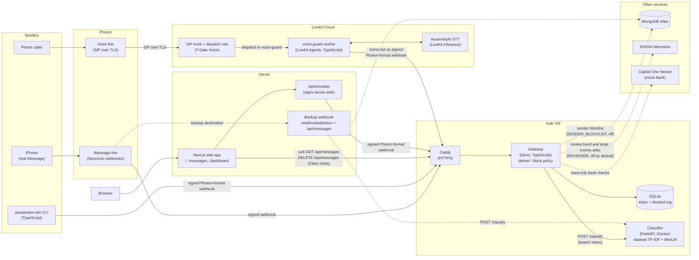

# T-Guard

T-Guard detects likely scam messages and warns the recipient. Built for HackUTD's **Safe Signal (T-Mobile)** and **Vultr** tracks.

The MVP uses one Photon iMessage line as the "victim". Real iMessages reach the gateway through Photon's webhooks, and a simulated "perpetrator" sends scam and legitimate messages from a message bank as Photon-format webhook calls. T-Guard classifies each message the victim receives as a potential scam or legitimate, blocks potential scams before they reach the victim's virtual inbox, and shows the result in the web app.

For the MVP, a Next.js page at `/messages` shows a 3D scene (React Three Fiber) above the delivered and blocked lists, with a Simulate sidebar and a dashboard at `/dashboard`. The stack is TypeScript for the gateway, simulator, voice worker and web app, and Python for the classifier: a stacked TF-IDF + MiniLM model served on Vultr ([`classifier/`](classifier/README.md)). Proposed, not final: a "potential scam blocked" notice that links to a blocked-scams panel with highlighted keywords.

Status: **MVP working end to end.** On `main`: the gateway (`services/gateway/`) on a Vultr VM with the stacked classifier (`stacked-lr-category@0.5`, block threshold 0.70 on the VM), the web app on Vercel (landing page, `/messages`, `/dashboard`, and a backup Photon webhook), the perpetrator simulator and message bank, the money-request warning, the Nemotron review (off by default) and the sender blocklist (parked, off by default). The voice scam guard (`services/voice-guard/`) transcribes calls on LiveKit Cloud and sends transcripts to the gateway; its production redeploy is still pending. See [`AGENTS.md`](AGENTS.md) for project context and the working agreement, [`CHANGELOG.md`](CHANGELOG.md) for design decisions, and [`data/README.md`](data/README.md) for the dataset. The demo walkthrough is in [`docs/DEMO.md`](docs/DEMO.md).

**Setting up accounts and credentials?** Start with [`docs/SETUP.md`](docs/SETUP.md) (Photon, Vultr, domain, Vercel, optional Atlas; Twilio isn't needed). Deploying the gateway: [`services/gateway/DEPLOY.md`](services/gateway/DEPLOY.md).

## Architecture

How the pieces connect on `main` (2026-11-08). Solid arrows are live paths; dotted ones are optional or off by default. The gateway alone decides deliver or block; the web app only reads and renders its decisions.

- **One decision path.** Real iMessages, simulated ones (CLI and the Simulate sidebar) and voice-call transcripts all arrive as signed Photon-format webhooks on `/webhooks/photon`, so the gateway handles them the same way: verify, dedupe, classify, apply policy (block threshold, review band, money warning), store, return `200`. It never replies to the sender.
- **Only text leaves the gateway.** The classifier gets message text and an opaque id, never phone numbers. Nemotron sees only found flags, counts and short labels from the bank checks.
- **Fail open.** If the classifier is down, the gateway delivers the message marked unverified.
- **Web app.** It reads whichever gateway `NEXT_PUBLIC_API_URL` points at (the VM by default, or the Vercel backup). Its only writes are Clear chats and Simulate (see `AGENTS.md`, "Decoupling rules"). Training runs separately on a Vultr Cloud GPU instance (`classifier/`); the trained artifacts are copied to the VM.

## Tech stack

- **Gateway:** TypeScript + Hono on a Vultr VM behind Caddy; SQLite inbox and blocked log.
- **Classifier:** Python + FastAPI in Docker on the VM; stacked TF-IDF + MiniLM (`all-MiniLM-L6-v2`), trained on a Vultr Cloud GPU.
- **Web app:** Next.js on Vercel, React Three Fiber (3D scene), Motion (animation); backup webhook stores to MongoDB Atlas.
- **Messaging:** Photon (Spectrum) iMessage webhooks.
- **Voice:** Photon voice line over SIP to LiveKit Cloud; `voice-guard` worker on LiveKit Agents (TypeScript), AssemblyAI STT through LiveKit Inference.
- **Simulator:** TypeScript CLI sending signed Photon-format webhooks.
- **Optional services:** NVIDIA Nemotron review, Capital One Nessie (mock bank), MongoDB Atlas sender blocklist (all off by default).

## Feature board

Every feature has a plan in [`docs/features/`](docs/features/) with ordered tasks and parallelization notes. New plans start from [`_TEMPLATE.md`](docs/features/_TEMPLATE.md).

| Feature | Plan | Phase | Status |
|---|---|---|---|
| Photon iMessage gateway: Spectrum webhook replaces Twilio, iMessage only | [photon-imessage.md](docs/features/photon-imessage.md) | MVP | In progress |
| Twilio MVP: webhook gateway, simulator, classifier, basic Next.js message UI (webhook part superseded by Photon) | [twilio-mvp.md](docs/features/twilio-mvp.md) | MVP | In progress |
| Classifier service: MiniLM trained and served on Vultr | [classifier-service.md](docs/features/classifier-service.md) | MVP | In progress |
| Live public demo: anyone texts the victim number, results shown in real time | _Not written yet_ | Later | Not started |
| Sender blocklist and scam fingerprints in MongoDB Atlas | [sender-blocklist.md](docs/features/sender-blocklist.md) | MVP | Parked: wired but off by default, per-message blocking only (#22, #23, #27) |
| Initial 3D scene: pink victim blob, sender shooting messages, potential scams blocked (first step of the parked 3D scene) | [initial-3d-scene.md](docs/features/initial-3d-scene.md) | Later | In progress (on `/messages` above the message lists, live polled data; magenta shield or hand guard, #14, #19, #68, #71) |
| Voice scam guard: Photon SIP call audio, transcript classification, and Vercel warning | [voice-scam-guard.md](docs/features/voice-scam-guard.md) | Later | In progress: STT worker on LiveKit Cloud (#63); transcripts go to the gateway webhook like simulated messages (#82). LiveKit Cloud redeploy with the gateway secrets remains |
| Potential Threat synthetic data: threat, coercion and fake-emergency extortion texts, proposed label 8 | [potential-threat-data.md](docs/features/potential-threat-data.md) | MVP | Data merged (#43); label 8 is Threats & Extortion (Timothy) and the served model has 9 classes |
| Simulation panel: sidebar buttons on `/messages` that send simulated iMessages to the gateway | [simulation-panel.md](docs/features/simulation-panel.md) | MVP | Done (#54; Rapid fire dataset #80) |
| Nemotron review: second opinion with Nessie bank checks for the review band and large money asks | [nemotron-review.md](docs/features/nemotron-review.md) | MVP | Code merged (#59, #70); off by default behind `REVIEWER` |
| Scam notice and blocked-scams panel, with keyword highlights (proposed) | _Not written yet_ | TBD | Not started |
| 3D conversation scene, Next.js + React Three Fiber (parked) | _Not written yet_ | Later | Not started |

## Active work

**Check this table and `gh pr list --state open` before starting anything.** Add a row when you start a task, open a draft PR right away so other branches can see the claim, and update the row as status changes. See `AGENTS.md`, "Claim the work".

| Feature | Task | Branch | Worked on by | Status | PR |
|---|---|---|---|---|---|
| Project docs | Add LiveKit to the tech stack (AGENTS.md, README) and the diagram | `docs/livekit-stack` | Tuan + Claude Code | Done | [#85](https://github.com/tuann72/HackUTD/pull/85) |
| Project docs | Architecture diagram in the README; sync docs with #82 | `docs/architecture-diagram` | Tuan + Claude Code | Done | — |
| Project docs | Sync `AGENTS.md` and the README trackers with merges #63 to #81 | `docs/sync-agents-readme` | Tuan + Claude Code | Done | — |
| Voice scam guard | Send each call transcript to the VM gateway as a signed Photon-format message, like the simulator | `feat/voice-scam-detection` | JP | Done | [#82](https://github.com/tuann72/HackUTD/pull/82) |
| Voice scam guard | Expose only `POST /classify` to LiveKit through the VM's Caddy | `fix/voice-classifier-proxy` | JP | Draft (not needed for voice since #82) | [#78](https://github.com/tuann72/HackUTD/pull/78) |
| Message UI | Model comparison table behind the model name on message cards | `feat/web-model-comparison` | lytx02 + Claude Code | Done | [#81](https://github.com/tuann72/HackUTD/pull/81) |
| Message UI | Remove the Simulate target line and the dashboard's "Masked by the gateway" note | `feat/web-trim-copy-2` | Tuan + Claude Code | Done | [#79](https://github.com/tuann72/HackUTD/pull/79) |
| Message UI | Rapid fire dataset: 200 complete sentences, 40% scam; Rapid fire draws from it | `feat/sim-rapid-dataset` | Tuan + Claude Code | Done | [#80](https://github.com/tuann72/HackUTD/pull/80) |
| Message UI | Remove small captions and the footer note on /messages; bigger Threats blocked / Delivered labels | `feat/web-trim-copy` | Tuan + Claude Code | Done | [#77](https://github.com/tuann72/HackUTD/pull/77) |
| Message UI | Remove the Grandparent scam button from the Simulate sidebar | `feat/web-no-grandparent` | Tuan + Claude Code | Done | [#74](https://github.com/tuann72/HackUTD/pull/74) |
| Message UI | Landing T: remove the black slab, add the right serif and two small pink squares beside the stem | `feat/landing-t-dots` | Tuan + Claude Code | Done | [#76](https://github.com/tuann72/HackUTD/pull/76) |
| Initial 3D scene | Shield's T in Manrope ExtraBold (closest free match to T-Mobile's TeleNeo) | `feat/scene-shield-t-font` | Tuan + Claude Code | Done | [#75](https://github.com/tuann72/HackUTD/pull/75) |
| Voice scam guard | Caller-only STT worker, after-call classifier, protected Vercel result API/UI, and LiveKit Cloud deployment (tasks 1.1–1.4, 1.6; call-script and production call evaluation pending) | `feat/voice-guard-call-results` | Codex | Done | [#63](https://github.com/tuann72/HackUTD/pull/63) |
| Message UI | Wordmark shield (the U in T-GUARD) as tall as the letters everywhere | `feat/web-logo-shield` | Tuan + Claude Code | Done | [#73](https://github.com/tuann72/HackUTD/pull/73) |
| Initial 3D scene | Shield/Hand switch above the scene (hand back as an option); Rapid fire button (50 msgs, 100 ms); iMessage demo and Smoke test removed | `feat/web-guard-toggle` | Tuan + Claude Code | Done | [#71](https://github.com/tuann72/HackUTD/pull/71) |
| Message UI | Message text size follows length (short = larger, long = smaller) | `feat/web-text-size` | Tuan + Claude Code | Done | [#72](https://github.com/tuann72/HackUTD/pull/72) |
| Initial 3D scene | Move the shield a little left (x 2.2 → 1.9); a white "T" replaces its check mark; the U in the GUARD wordmark is the shield | `fix/scene-shield-left` | Tuan + Claude Code | Done | [#69](https://github.com/tuann72/HackUTD/pull/69) |
| Initial 3D scene | Replace the hand and box with a pink (T-Mobile magenta) Lucide shield in the same spot | `feat/scene-shield` | Tuan + Claude Code | Done | [#68](https://github.com/tuann72/HackUTD/pull/68) |
| Message UI | No em dashes in UI, sortable most-active-numbers table, landing blocks form a "T" | `feat/web-ui-polish` | Tuan + Claude Code | Done | [#67](https://github.com/tuann72/HackUTD/pull/67) |
| Message UI | Dashboard page (`/dashboard`) and button; move T-Guard left of the Receiver, box text back, Receiver label at the bottom | `feat/web-dashboard` | Tuan + Claude Code | Done | [#65](https://github.com/tuann72/HackUTD/pull/65) |
| Message UI | Inter font (thicker), button hovers, no arrows on Simulate buttons, bean sender + Receiver bean behind the hand, "T-Guard" box label | `feat/web-theme-tweaks` | Tuan + Claude Code | Done | [#64](https://github.com/tuann72/HackUTD/pull/64) |
| Message UI | Restyle `/messages` after the T-GUARD prototype (paper/ink/pink, labels, counter row, light only) | `feat/web-messages-theme` | Tuan + Claude Code | Done | [#62](https://github.com/tuann72/HackUTD/pull/62) |
| Classifier data | 600 synthetic scam texts: government threats, IRS, ID/identification requests, health scams (150 each); merged by `build_splits.py` | `data/gov-health-id-irs-scams` | Tuan + Claude Code | Done (retrain not run) | [#61](https://github.com/tuann72/HackUTD/pull/61) |
| Nemotron review | Second-opinion review in the score band, with Nessie bank checks, behind `REVIEWER=off` | `feat/nemotron-review` | Timothy + Claude Code | Done | [#59](https://github.com/tuann72/HackUTD/pull/59) |
| Initial 3D scene | Replace the right (Receiver) blob with the T-GUARD pink box and a photographic hand that slaps blocked potential scams away (art and strike timings from the T-GUARD offline prototype) | `feat/scene-slap-hand` | Tuan + Claude Code | Done | [#60](https://github.com/tuann72/HackUTD/pull/60) |
| Simulation panel | Remove the "Burst settings" inputs from the Simulate sidebar (bursts use fixed defaults) | `fix/web-sim-remove-burst-settings` | Tuan + Claude Code | Done | [#58](https://github.com/tuann72/HackUTD/pull/58) |
| Classifier data | Merge the 300 free-ham rows into `scam_categories_100k(_full).csv` (100,300 rows); `build_splits.py` stops reading them separately | `data/free-ham-into-100k` | Tuan + Claude Code | Done (retrain not run) | [#57](https://github.com/tuann72/HackUTD/pull/57) |
| Classifier data | 300 harmless "free" ham texts ("feel free", "free pizza") so "free" stops reading as a scam cue; merged by `build_splits.py` | `data/free-ham-synthetic` | Tuan + Claude Code | Done (retrain not run) | [#56](https://github.com/tuann72/HackUTD/pull/56) |
| Message UI | Landing page at `/` with a Start button; scene + lists move to `/messages` | `feat/web-landing-page` | Tuan + Claude Code | Done | [#55](https://github.com/tuann72/HackUTD/pull/55) |
| Simulation panel | Sidebar buttons on `/messages` that run configurable simulations (presets, random bursts, custom text) through a server-side signing route | `feat/web-sim-panel` | Tuan + Claude Code | Done | [#54](https://github.com/tuann72/HackUTD/pull/54) |
| Project | Rename the project T-Gate → T-Guard (display name; technical ids unchanged) | `chore/rename-t-guard` | Tuan + Claude Code | Done | [#53](https://github.com/tuann72/HackUTD/pull/53) |
| Initial 3D scene | Sender label still missing: draw both labels as DOM over the canvas, placed each frame from the blob anchors (no drei `<Html>`) | `fix/scene-sender-label-overlay` | Tuan + Claude Code | Done | [#50](https://github.com/tuann72/HackUTD/pull/50) |
| Initial 3D scene | Bigger 3D scene band on `/` (taller band, camera reframed) | `feat/web-bigger-scene` | Claude (agent) | Done | [#48](https://github.com/tuann72/HackUTD/pull/48) |
| Initial 3D scene | Fast-slow-fast message flight (fast first 30%, slow middle 40%, fast last 30% of the distance) | `feat/scene-flight-easing` | Claude (agent) | Done | [#47](https://github.com/tuann72/HackUTD/pull/47) |
| Message UI | Remove the "Live" source pill from the T-Guard header | `fix/web-remove-live-indicator` | Claude (agent) | Done | [#49](https://github.com/tuann72/HackUTD/pull/49) |
| Initial 3D scene | Remove the legend overlay (Potential scam / Message) from the scene | `fix/scene-remove-legend` | Claude (agent) | Done | [#46](https://github.com/tuann72/HackUTD/pull/46) |
| Message UI | "Clear chats" deletes every message (`DELETE /api/messages` on the gateway and the Vercel backup) instead of hiding them | `feat/web-clear-deletes` | Tuan + Claude Code | Done | [#45](https://github.com/tuann72/HackUTD/pull/45) |
| Potential Threat data | Seeded synthetic threat/coercion rows (proposed label 8), hard negatives and held-out eval file (task 1.1) | `data/potential-threat-synthetic` | Tuan + Claude Code | Done | [#43](https://github.com/tuann72/HackUTD/pull/43) |
| Initial 3D scene | Sender label missing: draw each label inside its blob (bobs with it), pill background | `fix/scene-sender-label` | Tuan + Claude Code | Done | [#44](https://github.com/tuann72/HackUTD/pull/44) |
| Message UI | Remove the count/category tags under the T-Guard title | `fix/web-header-remove-tags` | Tuan + Claude Code | Done | [#42](https://github.com/tuann72/HackUTD/pull/42) |
| Message UI | Collapsible Inbox and Blocked sections | `feat/web-collapsible-lists` | Tuan + Claude Code | Done | [#41](https://github.com/tuann72/HackUTD/pull/41) |
| Initial 3D scene | Sender/Receiver labels under the blobs, rename Victim → Receiver, drop "(protected)" | `fix/scene-blob-labels` | Tuan + Claude Code | Done | [#40](https://github.com/tuann72/HackUTD/pull/40) |
| Message UI | Scam score as a percentage with two decimals, truncated (95.43%) | `fix/web-score-two-decimals` | Tuan + Claude Code | Done | [#39](https://github.com/tuann72/HackUTD/pull/39) |
| Message UI | "Clear chats" button on `/`: hides the current inbox/blocked messages in this browser (nothing deleted on the gateway) | `feat/web-clear-chats` | JP + Claude Code | Done (later replaced by #45, which deletes) | [#38](https://github.com/tuann72/HackUTD/pull/38) |
| Classifier service | Stacked model option, `train.py --model stacked` (task 1.5), deployed on the gateway VM | `feat/classifier-service-stacked` | Timothy + Claude Code | Done | — |
| Photon iMessage gateway | Photon 2.0 / Beta webhooks: registration script (`pho_prj_` → destinations API, `rotate`) and Standard Webhooks + `message.received` on the Vercel route | `feat/photon-beta-webhooks` | Tuan + Claude Code | Done | — |
| Photon iMessage gateway | Photon webhook on the Vercel site (`/webhooks/photon` + `/api/messages`, Atlas store), backup to the VM gateway | `feat/web-photon-webhook` | Tuan + Claude Code | In review | — |
| Sender blocklist | `DNS_SERVERS` for Atlas on Windows; drop deprecated `timeoutMS` | `fix/sender-blocklist-dns` | Timothy + Claude Code | Done | [#29](https://github.com/tuann72/HackUTD/pull/29) |
| Classifier service | Artifact-free tests + Vultr train/deploy scripts, not executed (task 1.4) | `chore/classifier-vultr-ready` | Tuan + Claude Code | Done | [#28](https://github.com/tuann72/HackUTD/pull/28) |
| Photon iMessage gateway | Simulator: rich iMessage content, demo scenario and demo script (task 1.8) | `feat/photon-sim-rich-content` | Tuan + Claude Code | Done | [#26](https://github.com/tuann72/HackUTD/pull/26) |
| Photon iMessage gateway | Deploy tooling and setup checklist: `docs/SETUP.md`, webhook registration script, VM deploy files, tunnel helper (task 1.7) | `chore/photon-deploy-tooling` | Tuan + Claude Code | Done | [#25](https://github.com/tuann72/HackUTD/pull/25) |
| Sender blocklist | Blocklist wired but parked behind `SENDER_BLOCKLIST` (default off), one-message restore route, email handle fix (tasks 1.1, 2.1, 2.2; photon-imessage 1.5) | `feat/sender-blocklist-gateway-flow` | Tuan + Claude Code | Done | [#27](https://github.com/tuann72/HackUTD/pull/27) |
| Photon iMessage gateway | Replace the Twilio webhook with Photon (Spectrum) iMessage webhooks: gateway, simulator, fixture, docs (task 1.1) | `feat/photon-imessage-gateway` | Tuan + Claude Code | Done | [#24](https://github.com/tuann72/HackUTD/pull/24) |
| Sender blocklist | Fingerprint + blocklist module (task 1.2) | `feat/sender-blocklist-module` | Timothy + Claude Code | Done | [#23](https://github.com/tuann72/HackUTD/pull/23) |
| Sender blocklist | Write the plan | `feat/sender-blocklist-plan` | Timothy + Claude Code | Done | [#22](https://github.com/tuann72/HackUTD/pull/22) |
| Initial 3D scene | Combine scene and messages on `/`, 2D bubble image (task 3.4) | `feat/initial-3d-scene-combined-page` | Tuan + Claude Code | Done | [#19](https://github.com/tuann72/HackUTD/pull/19) |
| Classifier service | MiniLM ([#3](https://github.com/lytx02/HackUTD/pull/3)) and TF-IDF ([#6](https://github.com/lytx02/HackUTD/pull/6)) code merged, **not yet run on full data**. Next: train both on Vultr (task 2.1; TF-IDF via README Option B), then deploy (task 3.1) | — | Tuan | Not started | — |

Status values: **In progress**, **Blocked**, **In review**, **Done**. "Worked on by" names the person and, if applicable, the agent (for example, `Tuan + Claude Code`).
